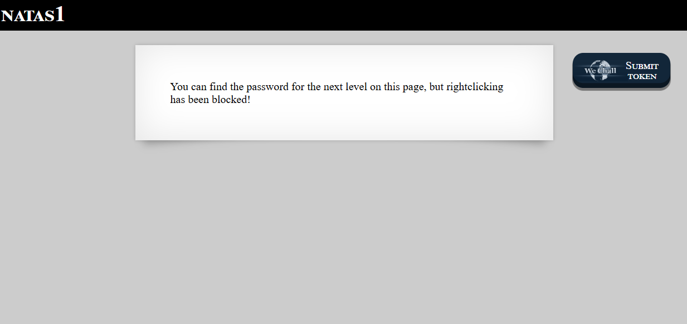
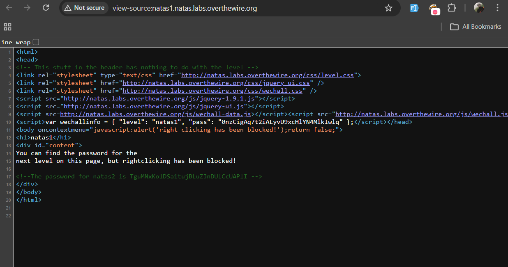

# Natas Level 1 → Level 2

### Challenge

**URL: http://natas1.natas.labs.overthewire.org/**

The page content matches the previous level, except right-click is disabled to block the context menu.

### Walkthrough

1. Since the context menu is blocked, open the page source another way:

- Press `Ctrl + U` (Windows/Linux) or `Cmd + Option + U` (Mac).
- Add `view-source:` before the URL in your address bar: `view-source:http://natas1.natas.labs.overthewire.org/`
- Press `F12` or `Ctrl + Shift + I` to open the Inspector directly.

2. Check the HTML comments in the source to find the password:
   

---

### Credentials Found

- **username:** `natas2`
- **Password:** `TguMNxKo1DSa1tujBLuZJnDUlCcUAPlI`
