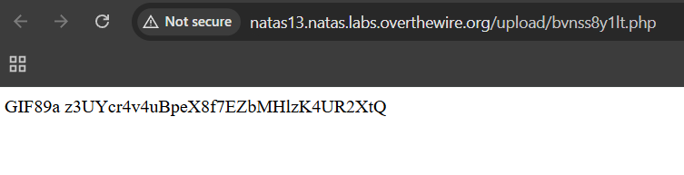

# Natas Level 13 → Level 14

### Challenge

**URL: http://natas13.natas.labs.overthewire.org/**

Level 13 works like Level 12, except the server calls `exif_imagetype()` to inspect the file's magic bytes. Uploads whose leading bytes do not match a valid image format (JPEG, PNG, or GIF) are rejected.

---

### Walkthrough

1. To pass `exif_imagetype()`, prepend the magic bytes of a GIF file (`GIF89a`) to the PHP payload.

2. Create a file on your computer (e.g., `solver.php`). We will start the file with the GIF signature and then follow it with our PHP code:

   ```
   GIF89a
   <?php
   echo shell_exec('cat /etc/natas_webpass/natas14');
   ?>
   ```

   The server's `exif_imagetype()` reads `GIF89a`, treats the file as a GIF image, and accepts the upload.

3. Modify the form and upload `solver.php`:
   - Right-click the page and select **Inspect** (F12) to open Developer Tools.
   - Find the hidden input: `<input type="hidden" name="filename" value="[random].jpg">`.
   - Double-click the `value` and change the extension from `.jpg` to `.php`.
   - Select your `solver.php` file in the file picker and click **Upload File**.

4. After a successful upload, the page will provide a link to the file location (e.g., `upload/[random].php`). Click the link, and the server will execute the PHP code, printing the password to the screen.
   

---

### Credentials Found

- **Username:** `natas14`
- **Password:** `z3UYcr4v4uBpeX8f7EZbMHlzK4UR2XtQ`
