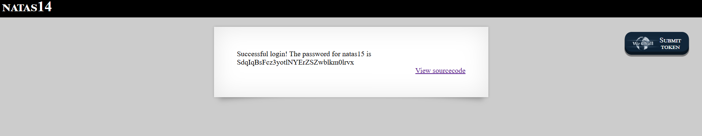

# Natas Level 14 → Level 15

### Challenge

**URL: http://natas14.natas.labs.overthewire.org/**

This level is vulnerable to SQL injection (SQLi) in the login form. The PHP script takes user input from a POST request and concatenates it directly into a SQL query enclosed in double quotes (`"`): `$query = "SELECT * from users where username=\"".$_REQUEST["username"]."\" and password=\"".$_REQUEST["password"]."\"";`

---

### Walkthrough

1. The database checks whether both username and password match a row in `users`: `SELECT * FROM users WHERE username="[USER]" AND password="[PASS]"`. To log in without a valid password, make the `WHERE` clause evaluate to `TRUE`.
2. While we can inject into either field, injecting into `password` avoids needing a valid username. Using `" or "1"="1` closes the password string and appends a condition that is always true.
3. Submit these credentials:
   - **Username:** `admin` (or any existing user, even blank)
   - **Password:** `" or "1"="1`

4. When submitted, the server executes the following: `SELECT * FROM users WHERE username="admin" AND password="" or "1"="1"`

   In SQL logic, the `AND` operator is evaluated before `OR`. The query is processed as: `(username="admin" AND password="") OR ("1"="1")`

   Even when the first part is false (because the password isn't blank), the second part (`"1"="1"`) is always `TRUE`, so the query returns a row, `mysqli_num_rows` is greater than 0, and the login succeeds.

5. Log in with the payload:
   - Type `admin` in the **Username** field.
   - Type `" or "1"="1` in the **Password** field.
   - Click **Login**.
     

---

### Credentials Found

- **Username:** `natas15`
- **Password:** `SdqIqBsFcz3yotlNYErZSZwblkm0lrvx`
