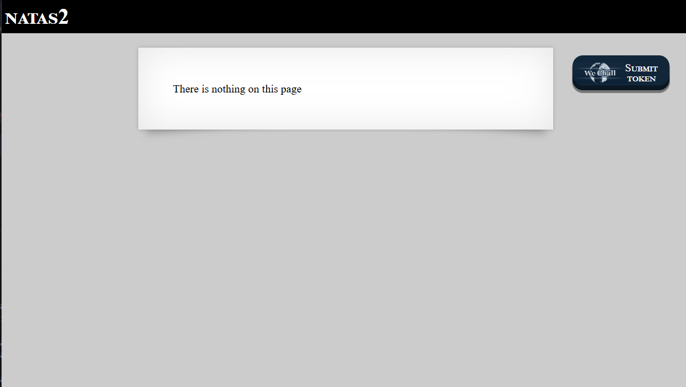
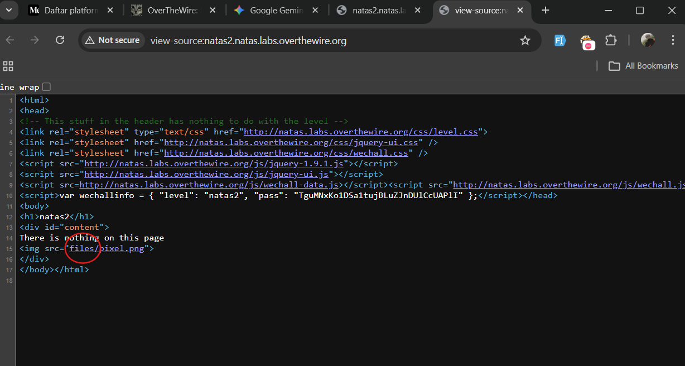
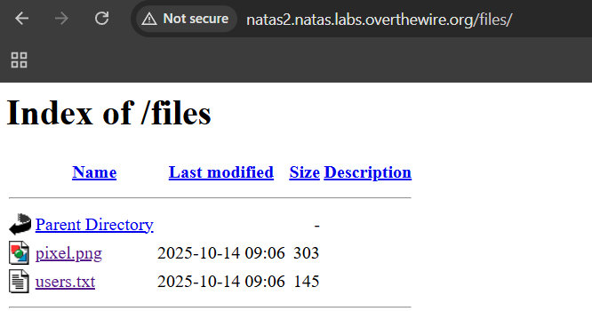
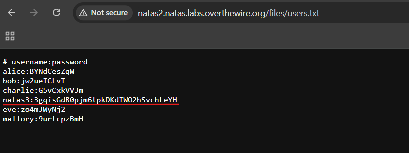

# Natas Level 2 → Level 3

### Challenge

**URL: http://natas2.natas.labs.overthewire.org/**

The page says "there is nothing on this page", and the password is not in an HTML comment. Check for files or directories left accessible on the server.

### Walkthrough

- View the source code (`Ctrl + U`). An `` tag points to `/files/`:
  
- Check whether directory indexing is enabled at `http://natas2.natas.labs.overthewire.org/files/`.
- Inside the directory listing, you will see two files:
  
- Open `users.txt`. This file contains a list of usernames and passwords. Look for the entry for `natas3`
  

---

### Credentials Found

- **username:** `natas3`
- **Password:** `3gqisGdR0pjm6tpkDKdIWO2hSvchLeYH`
