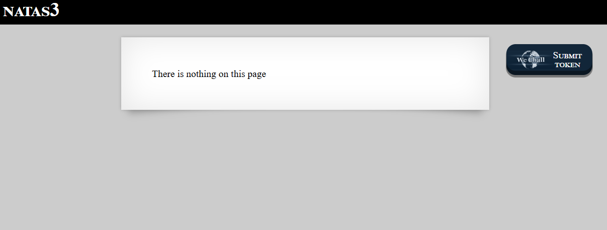
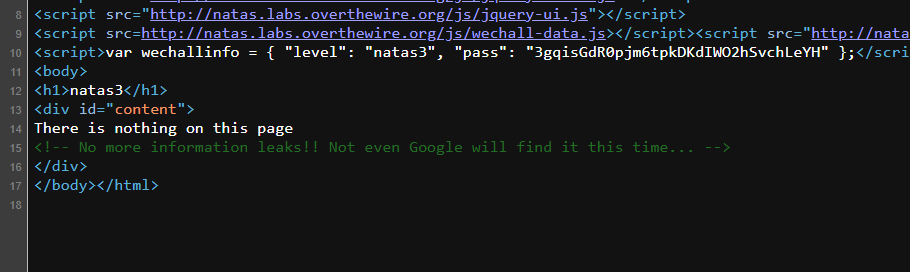
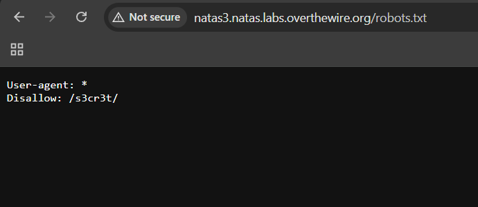
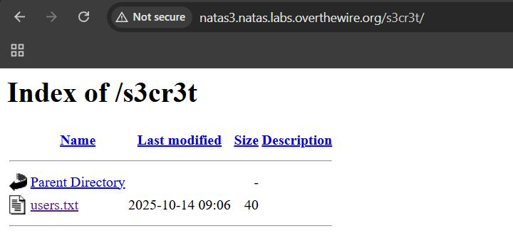
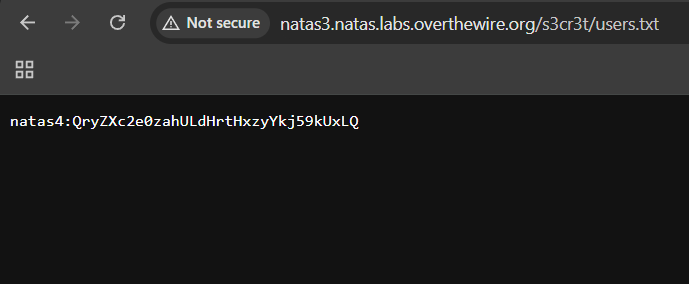

# Natas Level 3 → Level 4

### Challenge

**URL: http://natas3.natas.labs.overthewire.org/**

### Walkthrough

- The phrase _"No more information leaks!! Not even Google will find it this time..."_ points to `robots.txt`, which tells search engine crawlers which paths not to index.
  
- Open `http://natas3.natas.labs.overthewire.org/robots.txt`.
- It contains a `Disallow` entry for `/s3cr3t/`, showing that the directory exists on the server.
  
- Go to `http://natas3.natas.labs.overthewire.org/s3cr3t/`.
  
- Open `users.txt` from the directory listing to read the password for the next level.
  

---

### Credentials Found

- **username:** `natas4`
- **Password:** `QryZXc2e0zahULdHrtHxzyYkj59kUxLQ`
