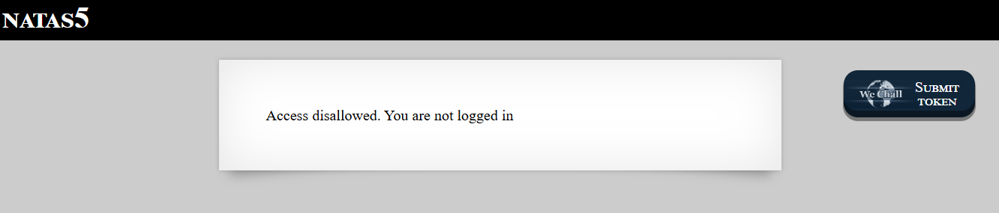
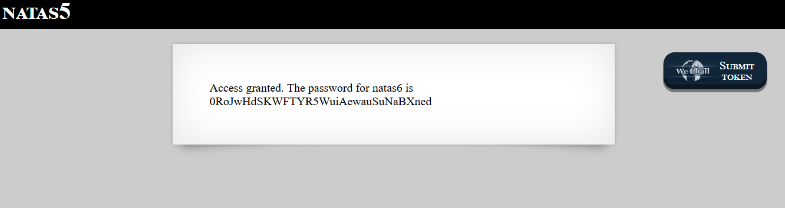

# Natas Level 5 → Level 6

### Challenge

**URL: http://natas5.natas.labs.overthewire.org/**

When you land on the page, it displays the message:

"Access disallowed. You are not logged in."

This level checks a cookie to verify whether you are logged in.

### Walkthrough

- Press `F12` or `Ctrl + Shift + I` and navigate to the **Storage** tab (Firefox) or **Application** tab (Chrome/Edge).
- On the left sidebar, expand the **Cookies** section and click on the Natas 5 URL. You will see a cookie named:
  - **Name:** `loggedin`
  - **Value:** `0`
- Change the value from `0` to `1`.
- Refresh the page. With `loggedin=1`, the server grants access.
  

---

### Credentials Found

- **username:** `natas6`
- **Password:** `0RoJwHdSKWFTYR5WuiAewauSuNaBXned`
